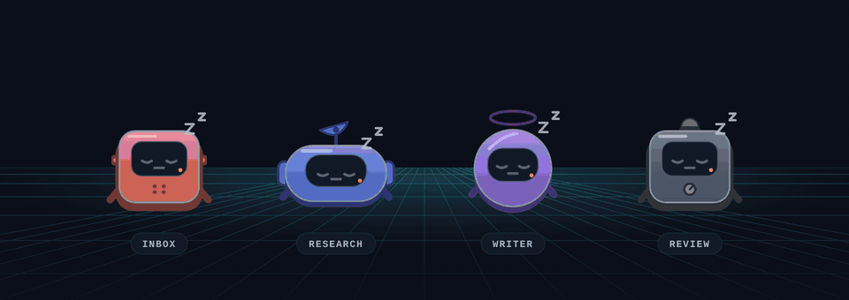

# Botons

**Your own team of AI agents, powered by the AI you already use.** Give each one a role, and they get to work: on your computer, on a schedule, together.

- **A team with roles.** Each Boton has its own chat, routines, memory and workspace. Make one for your inbox, one for research, one for writing.
- **The AI you already use.** Botons runs your own Claude Code or Codex, signed in on your computer. Or give a Boton an API key.
- **On your computer.** Self-hosted and open source: your files and logins stay with you. Check in from your phone over Tailscale or HTTPS.
- **On a schedule, together.** Routines run on a schedule or when a webhook calls, and Botons ask each other for help.
- **You stay in charge.** Sandboxed workspaces, approvals for risky steps, and an audit log of everything that matters.

## Install

You need Linux or macOS, Node 20 or newer, and Claude Code or Codex signed in on that computer (the installer can add one for you).

```sh
npx getbotons install
```

## Quick start

1. Run `npx getbotons install` and answer its questions.
2. Open the link it prints.
3. Approve the code the page shows: `botons pair --approve <code>`.
4. If setup asks for a brain, sign one in: `botons login claude` or `botons login codex`.
5. Make your first Boton: pick a look, give it a role, and say hello.
6. When you're ready, give it a routine or connect a service.

## Learn more

- [Install](docs/install.md) and [first run](docs/first-run.md), in detail
- [Working with your Botons](docs/using-botons.md): roles, starters, skills, routines
- [Access, HTTPS and pairing](docs/access.md) and [security](docs/security.md)
- [Operations](docs/operations.md), [backups](docs/backups.md) and [configuration](docs/configuration.md)
- [Docker](docs/DOCKER.md)
- [All the docs](docs/README.md), and [contributing](CONTRIBUTING.md)

## License and contact

MIT ([LICENSE](LICENSE)). Questions: [hello@getbotons.com](mailto:hello@getbotons.com). Report vulnerabilities privately ([SECURITY.md](SECURITY.md)).

Botons is independent and not affiliated with the makers of Claude Code or Codex.
