# Botons brand board

**A Boton is the body. You bring the brains.** Botons (said like "buttons") are small, always-on helpers drawn as little button-bots: a round, pill or keycap body, a lit face on a dark display, and swappable parts. They have no brains of their own; the owner gives them one by connecting Claude, Codex or an API key. The brand is electric and a bit playful, and it stays calm where the work happens. People trust Botons with their computer and their keys.

This folder holds the board. `board/index.html` is the live board (open it through any static server, for example `python3 -m http.server -d docs/brand/board`), and `node docs/brand/board/capture.ts` rewrites the images in `img/` from it and fails if a contrast target is missed. Nothing in the app imports these files; the app's renderer and tokens are drawn from the chosen direction.

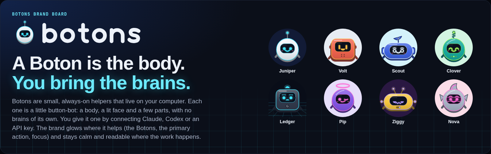

## Decision

| | Chosen | Options |
| --- | --- | --- |
| Character | **A · Lit**: a colored button shell with a little depth, a dark glass display with the face lit on it, and a thin rim of light, with detail levels by size | B · Neon line (outline only), C · Soft toy (matte, LCD face, no glow) |
| Logo | **A · Boton and wordmark**: a rounded monoline "botons" beside the brand Boton. The Boton alone is the app icon, the favicon and the sidebar mark | B · Face o, C · The button |
| Palette | Dark first: blue-black neutrals, Boton cyan for the primary action, focus and the active row; a light theme on white with a deeper cyan for text | |
| Type | System UI stack, heavier display settings, monospace for short uppercase labels, a drawn wordmark (no web fonts) | |
| Name | **Botons** for the product and the plural, **a Boton** for one | |

Why A: it's the only direction that keeps the neon character in **both** themes. The face glows on the Boton's own dark glass display, so it has the same contrast on white as on black, and the interface never needs a glowing background. B is the most Tron, but in light mode every Boton turns into a dark blob with an outline, and only the line color tells them apart. C is the calmest, but it gives up the electric feel the name asks for.

## The idea: bring the brains

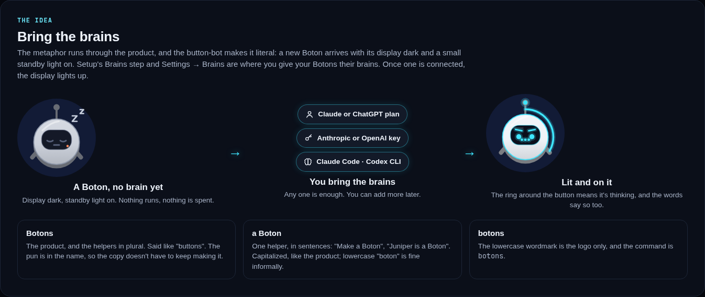

The metaphor runs through the product, and a button-bot makes it literal:

- A new Boton arrives with its **display dark** and a small standby light on. The words say the same thing ("No brain yet").
- The setup step is still **Bring the brains**, and Settings → Brains is where you give your Botons their brains. Once one is connected, the display lights up.
- While a Boton thinks, a **lit ring** runs around the button, like a button that's busy. The ring always comes with words ("Thinking…", the running step), so motion is never the only signal.

### The name in copy

- **Botons** is the product, and the plural: "Botons runs on your computer", "your Botons".
- **a Boton** is one helper: "Make a Boton", "Juniper is a Boton". Capitalized, like the product; lowercase "boton" is fine informally.
- The lowercase **botons** wordmark is the logo only.
- The `botons` command, the `getbotons` package, `~/.botons`, `BOTONS_*` settings and the service names stay as they are for now; user-facing text that must show the command keeps `botons`.

## Character directions

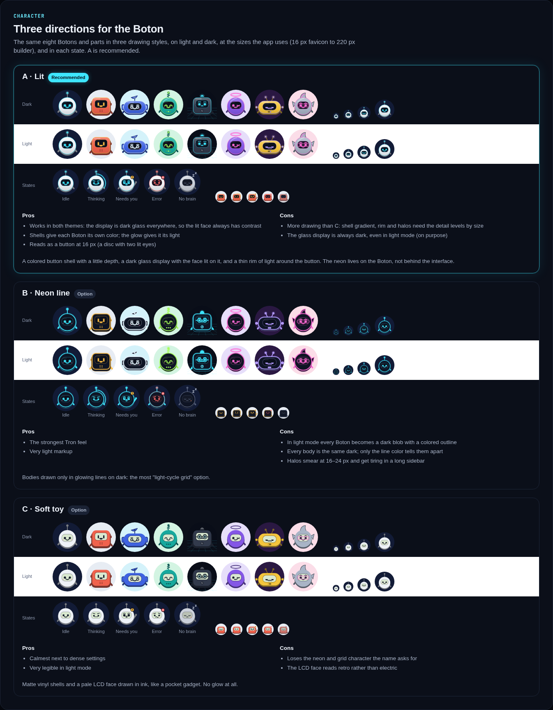

Each direction shows the same eight Botons and parts, on dark and light, at 16, 24, 32, 48 and 72 px, and in every state:

| State | What the Boton does | What else says it |
| --- | --- | --- |
| Idle | Its chosen eyes, brows and mouth, lit; blinks now and then | |
| Thinking | A lit ring runs around the button; eyes look down, the mouth is "…" | "Thinking…" and the running step |
| Needs you | Raises an arm, eyes wide, an amber "!" marker | The approval badge and text |
| Error | The face turns red, worried brows, a wobbly mouth, a red "×" marker | The error marker and message |
| No brain | Display dark, eyes closed, a standby light, "z" | "No brain yet" |

Detail drops away by size, like optical sizes in type. At 28 px and under, a Boton keeps its silhouette, rim light, eyes, mouth, top and state cue, and loses halos, ears, visor, panel and cheeks.

### Part sheet (A)

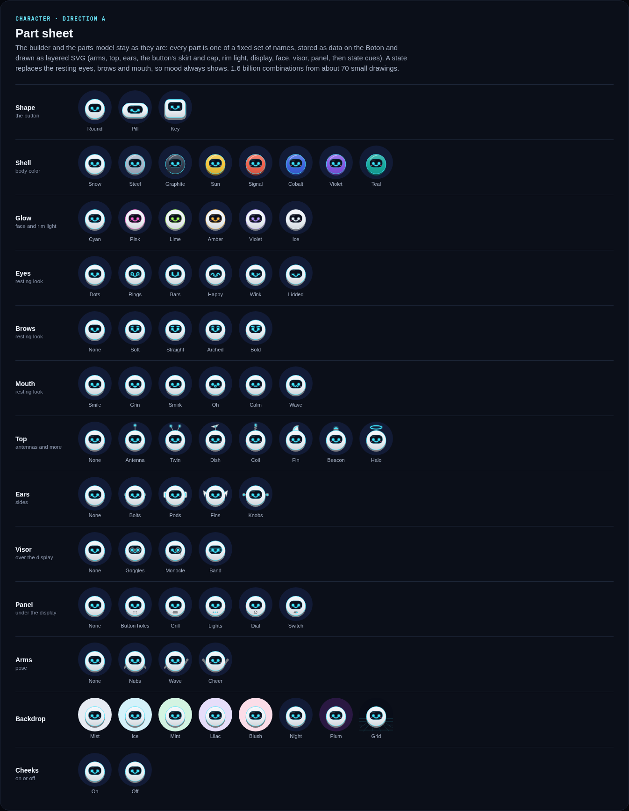

The builder and the parts model stay as they are: each part is one of a fixed set of names, stored as data on the Boton and drawn as layered SVG (arms, top, ears, the button's skirt and cap, rim light, display, face, visor, panel, then state cues).

| Part | Choices |
| --- | --- |
| Shape | Round, Pill, Key |
| Shell | Snow, Steel, Graphite, Sun, Signal, Cobalt, Violet, Teal |
| Glow | Cyan, Pink, Lime, Amber, Violet, Ice |
| Eyes | Dots, Rings, Bars, Happy, Wink, Lidded |
| Brows | None, Soft, Straight, Arched, Bold |
| Mouth | Smile, Grin, Smirk, Oh, Calm, Wave |
| Top | None, Antenna, Twin, Dish, Coil, Fin, Beacon, Halo |
| Ears | None, Bolts, Pods, Fins, Knobs |
| Visor | None, Goggles, Monocle, Band |
| Panel | None, Button holes, Grill, Lights, Dial, Switch |
| Arms | None, Nubs, Wave, Cheer |
| Backdrop | Mist, Ice, Mint, Lilac, Blush, Night, Plum, Grid |
| Cheeks | On, Off |

Over 1.5 billion combinations, from about 70 small drawings. The parts and characters are original; no names, marks or likenesses of any existing robot or character appear in the product.

### Earlier looks become Botons

Every Boton in an existing database holds an earlier look (a tater look), so the schema upgrade maps each one to its closest Boton field by field, with no randomness, and keeps the original beside it (backup first, reversible, nothing lost): shape (classic → round, tall → key, chunky → pill), toast → shell, wear color → glow, headwear → top (headphones become pod ears), glasses → visor, extras → panel; eyes, brows, mouth, arms and cheeks carry over by their nearest name; the backdrop keeps its light or dark.

## Palette

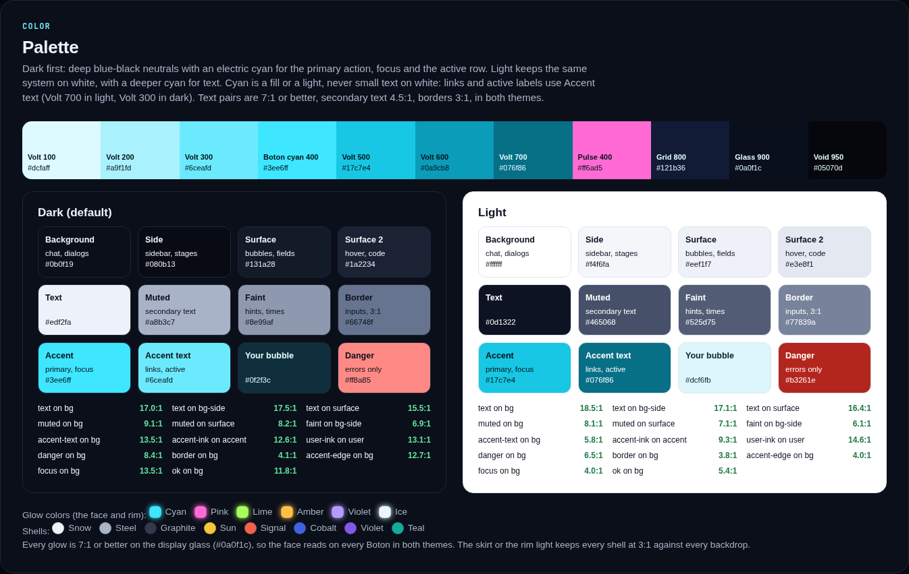

- **Brand scale:** Volt 100–700 (Boton cyan 400, `#3ee6ff`), Pulse 400 (`#ff6ad5`, characters and marketing only), Grid 800, Glass 900 (`#0a0f1c`, the display), Void 950.
- **Dark (default):** blue-black (`#0b0f19`) for the chat, a deeper side (`#080b13`) for the sidebar and stages, near-white text.
- **Light:** white for the chat, cool paper (`#f4f6fa`) for the sidebar and stages, ink text.
- **Cyan is a fill or a light, never small text on white.** Primary buttons are cyan with ink text; in dark they carry a soft glow. Links and active labels use `--accent-text`: `#076f86` in light and `#6ceafd` in dark.
- **Contrast targets** (checked by `capture.ts`): body text 7:1 or better, secondary text and links 4.5:1, borders, button edges and focus 3:1, in both themes. Every glow color is 7:1 or better on the display glass, and every shell stands out at 3:1 from every backdrop by its own color, its skirt or its rim light, lit or not (with no brain the rim stays as an unlit edge).
- Status colors stay conventional (red for errors, green for success, amber for "needs you") and are never the only signal.

The token file is [`board/tokens.css`](board/tokens.css), with semantic names only (`--bg`, `--surface`, `--accent`, `--accent-text`, `--glow`, `--grid-line`…), so the app and a future marketing site can share it.

## Where the neon goes

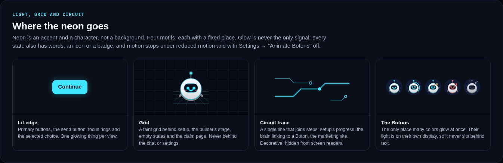

Neon is an accent and a character, not a background:

- **Lit edge:** the primary button, the send button, focus rings and the selected choice. One glowing thing per view.
- **Grid:** a faint grid behind setup, the builder's stage, empty states and the claim page. Never behind the chat or Settings.
- **Circuit trace:** a single decorative line joining steps (setup's progress, the marketing site), hidden from screen readers.
- **The Botons:** the only place many colors glow at once, on their own displays.
- The active row in the sidebar gets a lit edge on its left; the chat itself has no glow, no gradients and no grid.
- Motion (blink, ring, wave, "z") is decorative, pauses under reduced motion or with Settings → "Animate Botons" off, and every state is also said in words.

## Type

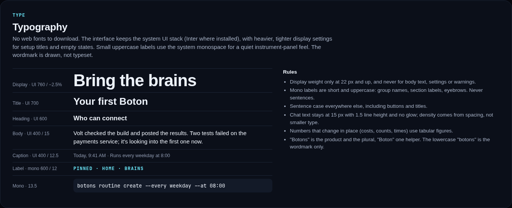

No web fonts. The interface keeps the system UI stack (Inter where installed); setup titles and empty states use heavier, tighter display settings. Short uppercase labels (sidebar groups, section labels, eyebrows) use the system monospace. The wordmark is drawn, not typeset. Chat text stays at 15 px with 1.5 line height.

## Logo, app icon and favicon

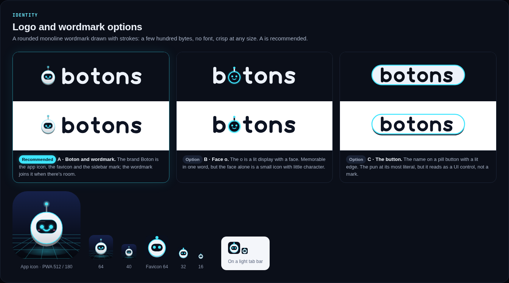

The wordmark is a rounded monoline drawn with strokes. The recommended logo, A, pairs it with the brand Boton (round, snow shell, cyan face, lit antenna), which also serves as the sidebar mark, the app icon (lit up over a light-cycle floor) and the favicon (a button, a dark display and two lit eyes, made for 16 px).

## Voice and copy

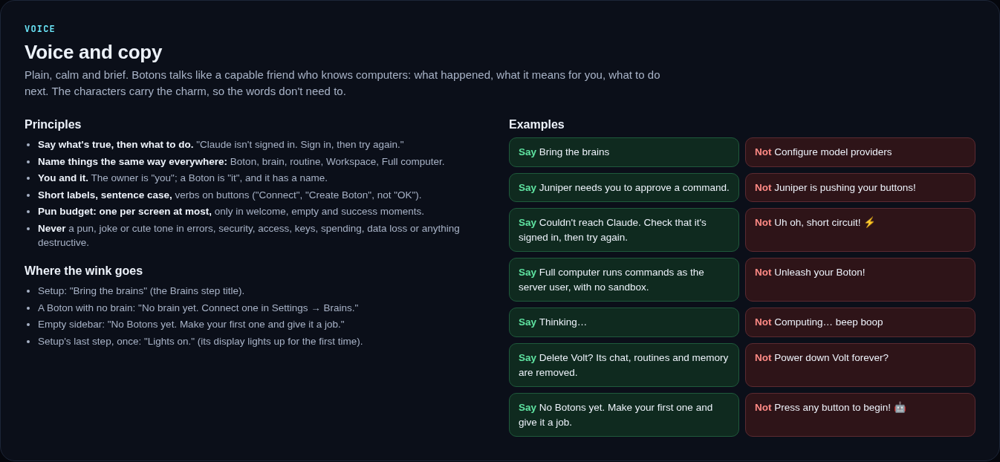

- Plain, calm, brief. Say what happened, what it means and what to do next.
- Name things the same way everywhere: Boton, brain, routine, Workspace, Full computer.
- The owner is "you"; a Boton is "it", and it has a name.
- Sentence case, and verbs on buttons.
- **Pun budget:** at most one per screen, only in welcome, empty and success moments. **Never** in errors, security, access, keys, spending, data loss or destructive confirmations. No robot clichés ("beep boop", "does not compute").
- The approved list to start from: "Bring the brains" (setup), "No brain yet" (a Boton without one), "No Botons yet. Make your first one and give it a job." (empty), "Lights on." (once, when setup finishes).

## Mockups

Desktop, dark and light:

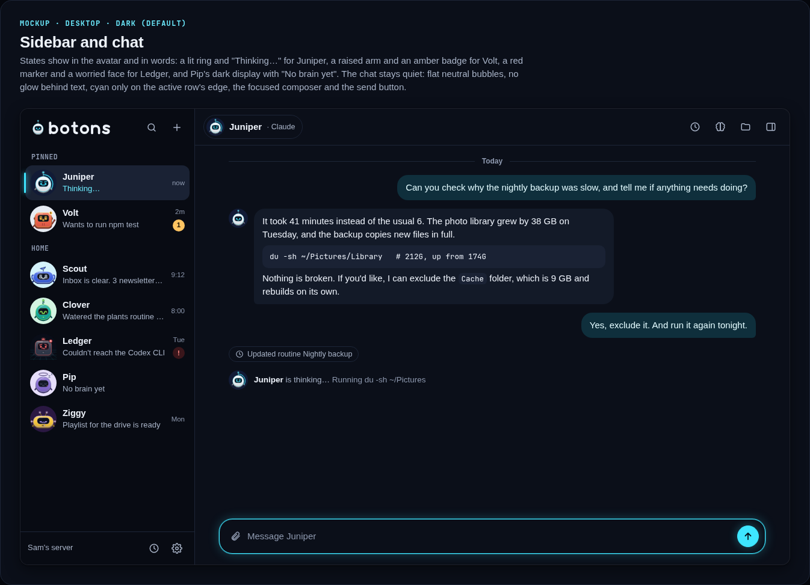
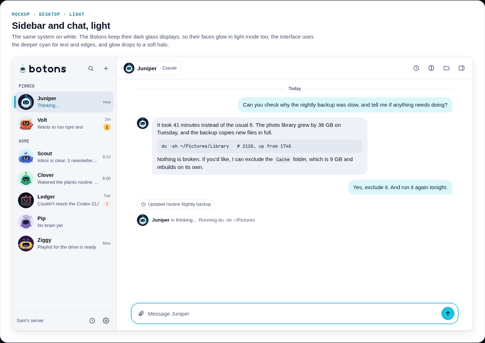

The Brains step, before and after a brain is connected:

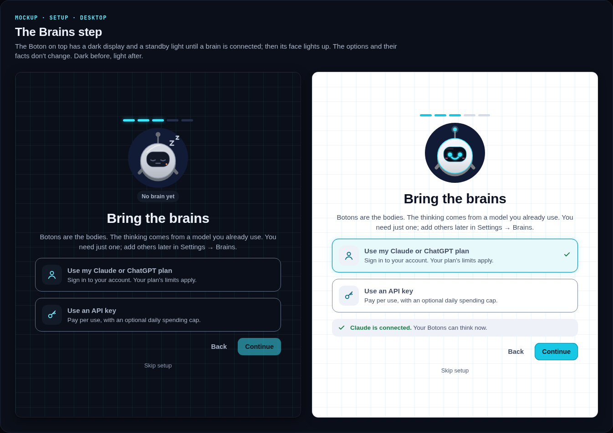

The Boton builder:

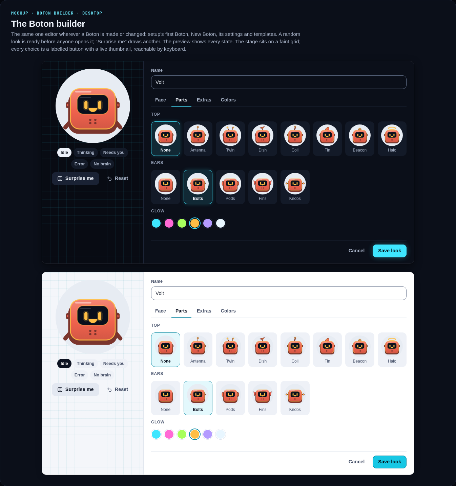

On a phone (chat, sidebar, setup, builder):

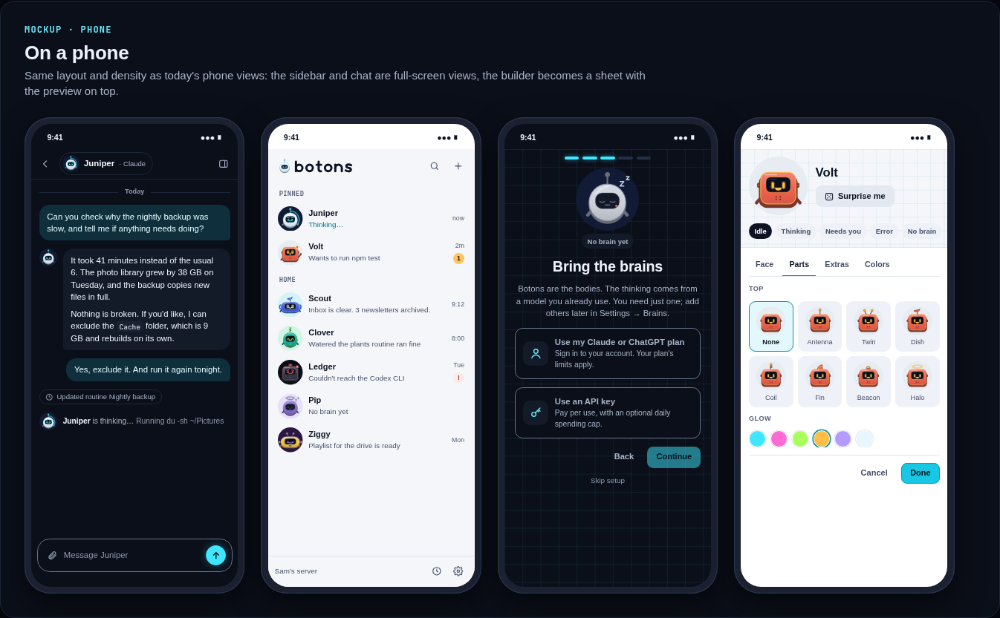

Claim, empty and error:

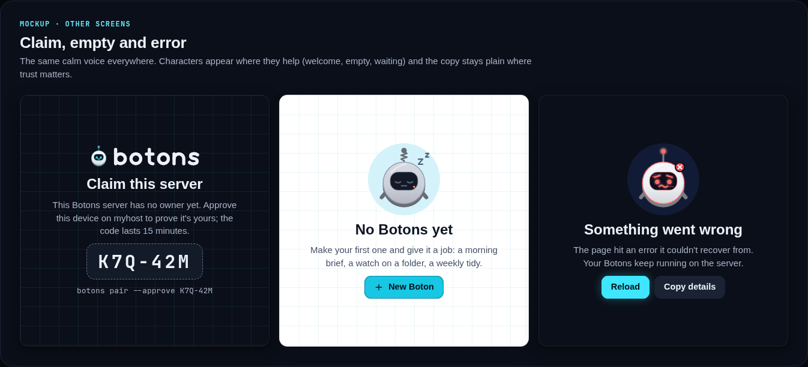

## How it gets built

A few reviewable pull requests, each with desktop and phone screenshots in dark and light in its description, small unit tests and an independent review:

1. **Tokens and palette.** The dark-first neon tokens and the light theme, written onto the app's existing theme switch.
2. **Marks.** The wordmark, the brand Boton, the app icon, the favicon and the PWA icons (`scripts/icons.ts`).
3. **Botons.** The renderer redrawn as button-bots with the size-based detail levels, the builder kept as it is, and a schema upgrade that maps each Boton's look to its closest Boton and keeps the original beside it.
4. **Copy.** Boton and Botons in everything the owner reads: onboarding, empty and loading states, the error and claim pages, installer output, doctor messages, page titles and the PWA manifest.
5. **Docs.** The README and docs branding, and this board as the brand's home.

Budgets: every new asset is SVG or CSS. The renderer stays under 12 KB gzipped, a Boton is at most about 45 SVG elements at full detail, glow is drawn with layered strokes (no SVG filters), and there's no new font or image download.

Not in scope yet: renaming the `botons` command, the `getbotons` package, the `~/.botons` folder, `BOTONS_*` settings, the service names and the repository; and the public marketing site, which reuses these tokens and marks later.
